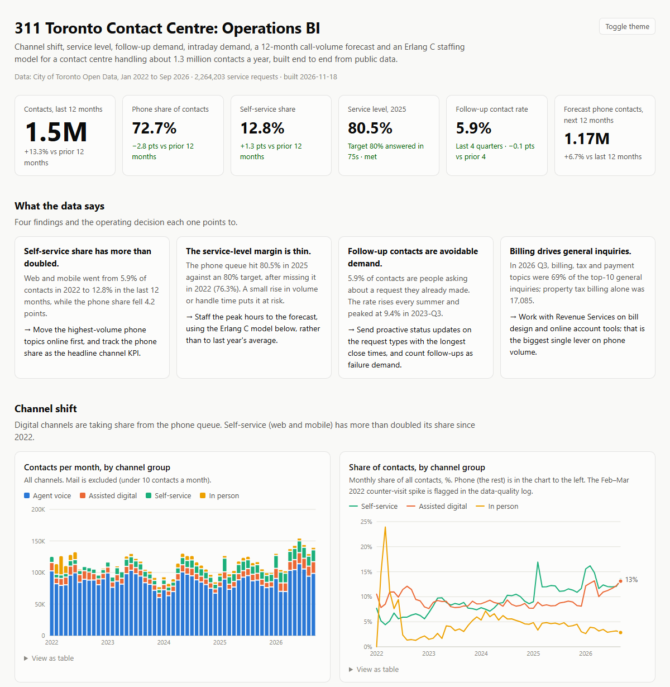

# Contact Centre Operations BI

**Live dashboard:** https://klovelace.github.io/contact-center-bi/

[](https://klovelace.github.io/contact-center-bi/)

An end-to-end business intelligence build for a large public contact centre, the 311 Toronto Contact Centre. It handles about 1.3 million contacts a year across phone, email, chat, social, web, mobile and in-person counters.

The project covers what a contact-centre BI function delivers:

- an automated data pipeline with quality checks
- a governed star-schema model
- KPI definitions
- a 12-month volume forecast
- an Erlang C staffing model
- an executive dashboard that turns all of this into operating decisions

It is built entirely on public data from the City of Toronto Open Data portal, so every number can be reproduced.

## What the data says

| Finding | Decision it supports |
|---|---|
| Self-service share (web and mobile) more than doubled, from 5.9% of contacts in 2022 to 12.8% in the last 12 months. Phone share fell 4.2 points. | Move the highest-volume phone topics online first. Track phone share as the headline channel KPI. |
| The phone service level met its 80%-in-75-seconds target in 2023–2025, but only by 0.5–1.9 points. It missed in 2022 (76.3%). | Staff peak hours to the forecast, using the Erlang C model, rather than to last year's average. |
| 5.9% of contacts are follow-ups on a request already made, peaking every summer (9.4% in 2023 Q3). | Send proactive status updates for slow-closing request types. Count follow-ups as failure demand. |
| Billing, tax and payment topics were 69% of the top-10 general inquiries in 2026 Q3. | Work with Revenue Services on bill design and online account tools. |

The phone forecast (damped Holt-Winters) had an 8.8% mean absolute percentage error on a 12-month holdout, against 12.4% for a same-month-last-year baseline.

## What's in the repo

```
pipeline/build_model.py   fetch → parse/repair → validate → model → forecast → dashboard
data/model/               star schema (CSV): dims, facts, forecast, data-quality log
docs/index.html           the dashboard (static, no dependencies; served by GitHub Pages)
powerbi/measures.dax      DAX measures for the same model in Power BI
powerbi/BUILD.md          relationships, page layout and publish steps for Power BI
tests/                    pytest checks on parsing, keys, reconciliation and the forecast
```

### Data model

| Table | Grain | Notes |
|---|---|---|
| `dim_date` | day | year, quarter, month, weekday, weekend flag |
| `dim_channel` | channel | channel group (Agent voice, Assisted digital, Self-service, In person), digital flag |
| `dim_sr_type` | request type | division and section |
| `dim_ward` | ward | 25 city wards |
| `fact_contacts_monthly` | month × channel | all inbound contacts |
| `fact_service_requests_monthly` | month × type × ward × status | 2.26M requests, 2022–2026 |
| `fact_service_requests_hourly` | day × hour × division | intraday demand shape |
| `fact_status_inquiries_quarterly` | quarter | follow-up contacts, with the quarter's total contacts |
| `fact_service_level_annual` | year | service level vs target |
| `forecast_phone_monthly` | month | actuals, fitted values, 12-month forecast with 80% interval |

### Data governance

Every load writes `data/model/data_quality_log.csv`, and the dashboard shows it. The checks include:

- **Source repair.** The raw service-request CSV is unquoted, so about 35,000 rows a year split on the comma in a division name ("Parks, Forestry & Recreation", later "Environment, Climate & Forestry"). The pipeline detects and re-joins them, and rejects and counts anything else malformed (under 0.005% of rows).
- **Reconciliation.** Every source row is accounted for in the fact tables.
- **Completeness.** No months missing from the contact series, and wards are populated.
- **Taxonomy.** Every channel maps to a channel group, and spelling variants ("Counter visits") are normalised.
- **Outliers.** A month above 3× its channel's median is flagged for review, not silently dropped. This catches the Feb–Mar 2022 counter-visit spike.
- **Model quality.** The forecast must beat a naive baseline on holdout.

## Run it

```bash
python -m venv .venv
.venv/Scripts/pip install -r requirements.txt   # macOS/Linux: .venv/bin/pip
.venv/Scripts/python pipeline/build_model.py
.venv/Scripts/python -m pytest -q
```

The pipeline downloads the source files into `data/raw/` on first run, rebuilds `data/model/`, and regenerates `docs/index.html`.

## Assumptions and limits

- Service level is published annually and follow-up volume quarterly. Monthly figures are not public.
- Average handle time and shrinkage are not published. The staffing model takes them as inputs (defaults: 6 minutes, 35%).
- The intraday demand shape comes from service-request creation times across all channels. It is a proxy for phone arrival patterns.

## Source and licence

Data: City of Toronto Open Data, *311 Contact Centre Performance Metrics* and *311 Service Requests – Customer Initiated*. Contains information licensed under the Open Government Licence – Toronto.
